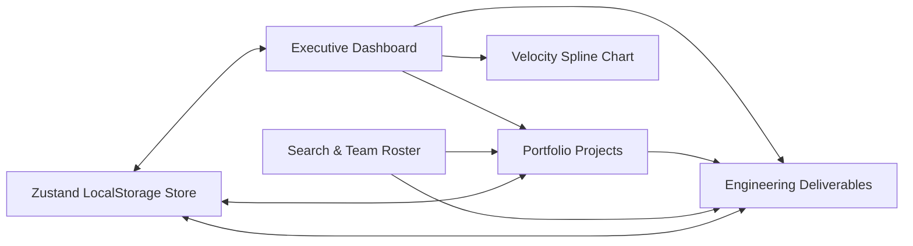

# NexaFlow ⚡

> **Next-Generation Project Portfolio & Engineering Task Management Hub**  
> Built with Next.js 16 (App Router), React 19, TypeScript, Tailwind CSS v4, Zustand, and Inter typography. Zero-configuration, local-first persistence, dual Cyber Dark & Clean Light themes, and interactive guided tours.

---

[](https://nextjs.org/)
[](https://react.dev/)
[](https://www.typescriptlang.org/)
[](https://tailwindcss.com/)
[](https://github.com/pmndrs/zustand)
[-4F46E5?style=flat-square)](https://rsms.me/inter/)
[](LICENSE)

---

## 📑 Table of Contents

1. [Overview](#-overview)
2. [Key Features](#-key-features)
3. [Architecture & Design System](#-architecture--design-system)
4. [How to Use the App (User Guide)](#-how-to-use-the-app-user-guide)
   - [1. First Launch & Guided Tours](#1-first-launch--guided-tours)
   - [2. Managing Projects](#2-managing-projects)
   - [3. Managing Deliverables & Tasks](#3-managing-deliverables--tasks)
   - [4. Multi-Vector Search & Team Filtering](#4-multi-vector-search--team-filtering)
   - [5. Understanding the Velocity Spline Chart](#5-understanding-the-velocity-spline-chart)
   - [6. Switching Themes & Personas](#6-switching-themes--personas)
   - [7. Keyboard Shortcuts](#7-keyboard-shortcuts)
5. [Deployment Guide](#-deployment-guide)
   - [Prerequisites](#prerequisites)
   - [Local Development](#local-development)
   - [Production Build & Self-Hosting](#production-build--self-hosting)
   - [Deploying to Vercel (One-Click)](#deploying-to-vercel-one-click)
   - [Deploying to Netlify](#deploying-to-netlify)
   - [Deploying with Docker](#deploying-with-docker)
   - [Zero-Config / No Environment Variables Guarantee](#zero-config--no-environment-variables-guarantee)
6. [Project Structure](#-project-structure)
7. [Troubleshooting & FAQ](#-troubleshooting--faq)

---

## 🌟 Overview

**NexaFlow** is a modern project portfolio and sprint deliverable workspace created for fast-moving engineering teams, product managers, and team leads.

It bridges the gap between high-level executive portfolio tracking and day-to-day engineering execution without the friction of heavyweight, slow enterprise tools.

### Why NexaFlow?

- **Zero-Friction Deployment**: 100% client-side local-first architecture powered by Zustand and browser `localStorage`. No database setup, no API keys, and no backend configuration required.
- **Air-Gapped & Offline Ready**: Bundled with `@fontsource/inter` and local SVG icons. Zero external Google Font CDN or network dependencies.
- **High-Contrast Cyberpunk & Clean Canvas Aesthetics**: Deep, solid `#0D0E12` / `#1C1C1F` Cyber Dark Space theme and high-readability Clean Light Canvas with instantaneous theme switching.
- **Micro-Interactions & Accessible Guidance**: Built-in 330+ contextual tooltips, two full guided onboarding tours, and interactive multi-vector search.



---

## 🚀 Key Features

### 1. Executive Dashboard & Metrics
- **Live KPI Counters**: Real-time tracking of Active Projects, Tasks in Progress, Completed Tasks with progress ratios, and Overdue Deliverables.
- **Dual-Spline Activity Chart**: Mathematical cubic-bezier SVG visualization comparing weekly engineering **Velocity** (throughput) against **Completion Rate** (delivery precision) across all 7 days.
- **Dynamic Quick Links**: Jump directly from metrics cards into filtered task views.

### 2. Project Portfolio Management
- **Project Cards**: Visual health indicators, color badges, progress bars, delivery dates, and assigned project leads.
- **Portfolio Controls**: Filter projects by status (`All`, `In Progress`, `Pending`, `Completed`) and sort by `Deadline (Earliest)`, `Progress (Highest)`, or `Name (A-Z)`.
- **Deep Linking**: Click **"Tasks & Team →"** on any project card to instantly focus the task table on that specific project and its team.
- **Create & Edit Modals**: Form with project title, manager assignment, target deadline, color swatch, and description.

### 3. Team Deliverables & Task Table
- **1-Click 3-State Status Toggles**: Directly click any status badge (`To Do` → `In Progress` → `Done`) without opening modal dialogues. Completed items feature strikethrough styling and verification badges.
- **Priority Indicators**: High, Medium, and Low urgency badges.
- **Overdue Detection**: Real-time alerts for overdue deliverables that require escalation.
- **Cascade Deletion**: Safely manage projects with automatic cascade handling of dependent tasks and confirmation modals.

### 4. Multi-Vector Search & Team Roster
- **Omni-Search Bar**: Instant real-time fuzzy matching across:
  - Task titles (e.g. `auth`, `pipeline`, `migration`)
  - Project names (e.g. `Website Redesign`, `Core Engine`)
  - Project leads (e.g. `Alex`, `Sarah`)
  - Task assignees (e.g. `Marcus`, `Elena`)
- **"People Involved" Interactive Roster**: Shows avatar chips for all active contributors. Click any team member's avatar to immediately isolate all tasks assigned to them; click again to clear.
- **Dedicated Project Dropdown**: Switch task views between specific projects or view all initiatives together.

### 5. Interactive Guided Tours & Navbar Help System
- **Navbar Help Dropdown**: Click the **Help (?)** button in the top navigation bar to access:
  1. 🧭 **Help to use the app**: 6-step guided walkthrough across metrics, projects, tasks, filters, and theme toggling.
  2. 📁 **How to create projects & tasks**: 5-step interactive product tour with live shortcut buttons (`Launch Project Modal`, `Launch Task Modal`) to practice right away.
  3. ⌨️ **Keyboard Shortcuts**: Immediate toast hotkey cheat-sheet.
- **Replay Anytime**: Tours can be relaunched anytime from the **Settings** view.

### 6. Local-First Persistence & Persona Switcher
- **State Persistence**: All project creations, task status updates, and view preferences persist seamlessly in `localStorage` under `nexaflow-storage`.
- **Seed Data Reset**: Easily restore default demo data at any time via Settings with a single click.
- **Manager Persona Switcher**: Switch the active user between Alex (Lead Architect), Sarah (Product Lead), Marcus (Principal Engineer), and Elena (UI/UX Director).

---

## 🎨 Architecture & Design System

| Layer | Technology | Details |
|---|---|---|
| **Framework** | Next.js 16.4.4 | App Router with Turbopack fast refreshes |
| **Runtime / Language** | React 19 & TypeScript 5 | Full type safety and modern concurrent React hooks |
| **Styling** | Tailwind CSS v4 & PostCSS | Solid dark surface `#1C1C1F`, no blur haze, CSS variables |
| **Typography** | `@fontsource/inter` | Local-first bundling, tabular numbers (`tnum`), zero external font CDNs |
| **State Management** | Zustand 5 | Atomic selectors, persistent storage middleware |
| **Icons** | Lucide React | Clean, minimalist, modern iconography |

---

## 📖 How to Use the App (User Guide)

### 1. First Launch & Guided Tours
When you open NexaFlow for the first time, or whenever you need assistance:
1. Look at the top navigation bar and click the **Help** button (with the **?** icon).
2. Choose **Help to use the app** to launch the comprehensive workspace tour.
3. Use the **Next →** and **← Back** buttons (or your keyboard's **Left/Right Arrow keys**) to navigate through the 6 highlights.
4. Press **Esc** or click **Skip / Done** at any time to close the tour.

---

### 2. Managing Projects

#### Creating a New Project
1. In the sidebar or top bar, navigate to **Projects** (or use the **Projects** section on the main dashboard).
2. Click the **+ New Project** button.
3. Fill in the modal details:
   - **Project Name**: Enter a descriptive title (e.g. *Payment Gateway V2*).
   - **Lead Manager**: Select the project owner from the team roster.
   - **Target Deadline**: Pick the target completion date.
   - **Accent Color**: Choose a color swatch to visually identify this project.
   - **Description**: Add brief context or goals.
4. Click **Create Project**. The project will instantly appear in your portfolio with real-time KPI updates.

#### Filtering and Sorting Projects
- Click the status tabs above the project grid: **All**, **In Progress**, **Pending**, or **Completed**.
- Use the **Sort by** dropdown to order projects by **Deadline**, **Progress**, or **Name**.
- Click **Tasks & Team →** on any project card to jump straight to the task table filtered by that project.

---

### 3. Managing Deliverables & Tasks

#### Creating a Task
1. Scroll down to the **Team Tasks** section or navigate to the **Tasks** tab.
2. Click **+ New Task**.
3. Fill in the task modal:
   - **Task Title**: Name the deliverable (e.g. *Implement OAuth2 Refresh Tokens*).
   - **Project**: Select which project this deliverable belongs to.
   - **Assignee**: Assign a team member.
   - **Priority**: Choose `High`, `Medium`, or `Low`.
   - **Due Date**: Set the expected delivery date.
4. Click **Create Task**.

#### Updating Task Status (The 1-Click Cycle)
- In the task table, locate the **Status** badge on any task.
- Click directly on the badge to cycle its state:
  $$\text{To Do} \longrightarrow \text{In Progress} \longrightarrow \text{Done} \longrightarrow \text{To Do}$$
- When marked as **Done**, the task gets an emerald checkmark badge, strikethrough text styling, and immediately updates the project's progress bar and overall completion rate.

---

### 4. Multi-Vector Search & Team Filtering

NexaFlow offers several ways to filter and locate deliverables:

| Action | How to do it |
|---|---|
| **Global Keyword Search** | Type in the top search bar (`Search tasks, projects, people...`). Results match across task titles, project names, leads, and assignees. |
| **Filter by Project** | Use the project dropdown in the Team Tasks header to view only tasks for a specific project. |
| **Filter by Contributor** | Click any contributor's avatar chip in the **People Involved** roster bar. The table immediately narrows down to deliverables assigned to that person. Click the chip again to unselect. |
| **Filter by Priority / Status** | Use the quick filter pills above the task table to isolate high-priority or in-progress items. |

---

### 5. Understanding the Velocity Spline Chart

The **Team Activity** chart on the dashboard provides a weekly pulse of engineering performance:

```
Index (0-100)
 100 ┼- - - - - - - - - - - - - - - - - - - - - - - - - ●  (Velocity peak)
  75 ┼- - - - - - - - - - - - - - - - - - - - - - - - -/ 
  50 ┼- - - - - - - - - - - - - - - - - - - - - - - - / - - ● (Completion Rate)
  25 ┼- - - - - - - - - - - - - - - - - - - - - - - -/
   0 ┼───┴───────┴───────┴───────┴───────┴───────┴───────┴
       Sun      Mon     Tue     Wed     Thu     Fri     Sat
```

- **Horizontal Axis (X-axis)**: The 7 days of the work week (`Sun` through `Sat`).
- **Vertical Axis (Y-axis)**: Performance index scale from `0` to `100`.
- **Cyan Spline (`Velocity`)**: Measures engineering momentum, active commits, and throughput volume.
- **Violet Spline (`Completion Rate`)**: Measures the percentage of sprint deliverables formally closed and verified.
- **Interactive Tooltips**: Hover your mouse over any point on the curve to inspect daily numbers.

---

### 6. Switching Themes & Personas

- **Theme Toggle**: Click the Sun/Moon icon in the sidebar or header to switch between **Cyber Dark Space** and **Clean Light Canvas**.
- **Persona Switcher**: Go to the **Settings** view to switch between different team leads (Alex, Sarah, Marcus, Elena) and observe personalized dashboard context.
- **Reset Data**: If you want to start fresh with clean sample data, click **Reset to Demo Data** in the Settings tab.

---

### 7. Keyboard Shortcuts

| Shortcut | Action |
|---|---|
| `Esc` | Close any open modal dialogue, search dropdown, or tour popover |
| `Tab` / `Shift + Tab` | Navigate between form inputs and interactive buttons |
| `←` (Left Arrow) | Go to previous step in guided tours |
| `→` (Right Arrow) | Go to next step in guided tours |

---

## 🚢 Deployment Guide

NexaFlow is designed for instant zero-configuration deployment. It does not require any database, external API services, or server-side credentials.

### Prerequisites

- **Node.js**: `v20.9.0` or higher (Node 22 / 24 LTS recommended)
- **Package Manager**: `npm`, `pnpm`, or `yarn`

---

### Local Development

1. **Clone the repository**:
   ```bash
   git clone https://github.com/your-username/nexaflow.git
   cd nexaflow/nexaflow # or root depending on checkout
   ```

2. **Install dependencies**:
   ```bash
   npm install
   ```

3. **Start the development server**:
   ```bash
   npm run dev
   ```

4. **Open in browser**:
   Open [http://localhost:3000](http://localhost:3000) to view the application with hot-module reload.

---

### Production Build & Self-Hosting

To compile a minified, production-ready build for your own server or VPS:

```bash
# 1. Compile optimized build
npm run build

# 2. Run the production server
npm run start
```
By default, NexaFlow listens on port `3000`. You can configure a custom port using:
```bash
PORT=8080 npm run start
```

---

### Deploying to Vercel (One-Click)

The simplest way to deploy NexaFlow with global edge distribution:

1. Push your repository to **GitHub**, **GitLab**, or **Bitbucket**.
2. Go to [Vercel Dashboard](https://vercel.com/dashboard) and click **Add New > Project**.
3. Import your NexaFlow repository.
4. If your Next.js project is located in the `nexaflow/` subfolder, set **Root Directory** to `nexaflow`.
5. Keep default settings:
   - **Framework Preset**: Next.js
   - **Build Command**: `npm run build`
   - **Output Directory**: `.next`
6. Click **Deploy**. Vercel will build and deploy the app in under 60 seconds.

---

### Deploying to Netlify

1. Push to GitHub and log in to [Netlify](https://app.netlify.com/).
2. Click **Add new site > Import an existing project**.
3. Select your Git provider and repository.
4. Set **Base directory** to `nexaflow` (if in subfolder) and **Build command** to `npm run build`.
5. Set **Publish directory** to `.next`.
6. Click **Deploy NexaFlow**.

---

### Deploying with Docker

NexaFlow includes support for containerized deployment. Here is a production multi-stage `Dockerfile`:

```dockerfile
# Stage 1: Dependencies
FROM node:24-alpine AS deps
WORKDIR /app
COPY package*.json ./
RUN npm ci

# Stage 2: Builder
FROM node:24-alpine AS builder
WORKDIR /app
COPY --from=deps /app/node_modules ./node_modules
COPY . .
ENV NEXT_TELEMETRY_DISABLED=1
RUN npm run build

# Stage 3: Runner
FROM node:24-alpine AS runner
WORKDIR /app
ENV NODE_ENV=production
ENV PORT=3000
ENV HOSTNAME="0.0.0.0"

COPY --from=builder /app/public ./public
COPY --from=builder /app/.next/standalone ./
COPY --from=builder /app/.next/static ./.next/static

EXPOSE 3000
CMD ["node", "server.js"]
```

To build and run:
```bash
docker build -t nexaflow:latest .
docker run -p 3000:3000 nexaflow:latest
```

---

### Zero-Config / No Environment Variables Guarantee

> [!NOTE]
> NexaFlow requires **no `.env` file** and **zero environment variables** to build and run. All initial project portfolios, team rosters, and task workflows are initialized dynamically and persist directly in the user's browser via `localStorage`.

---

## 📂 Project Structure

```text
nexaflow/
├── src/
│   ├── app/
│   │   ├── globals.css         # Theme tokens, font variables, and utilities
│   │   ├── layout.tsx          # Root layout & @fontsource/inter font definition
│   │   └── page.tsx            # Main application shell and tab router
│   ├── components/
│   │   ├── dashboard/
│   │   │   ├── ActivityChart.tsx       # Dual-spline SVG velocity chart
│   │   │   ├── GuidedTourModal.tsx     # 6-step workspace onboarding tour
│   │   │   ├── Header.tsx              # Search bar, Help menu, and notifications
│   │   │   ├── ProjectFormModal.tsx    # Modal for creating & editing projects
│   │   │   ├── ProjectList.tsx         # Portfolio grid, status filter, and sorting
│   │   │   ├── ProjectTaskTourModal.tsx# 5-step project/task creation product tour
│   │   │   ├── SettingsSection.tsx     # Persona switcher, theme options, tour reset
│   │   │   ├── Sidebar.tsx             # Collapsible primary navigation
│   │   │   ├── StatsCards.tsx          # 4 core KPI summary cards
│   │   │   └── TaskTable.tsx           # Deliverables table, team roster, 3-state status
│   │   └── ui/
│   │       ├── Badge.tsx               # Status & priority badges
│   │       ├── Button.tsx              # Primary, outline, and ghost action buttons
│   │       ├── ConfirmDialog.tsx       # Deletion & reset confirmation modals
│   │       ├── GlassCard.tsx           # Solid surface container with theme borders
│   │       ├── Input.tsx               # Accessible form input
│   │       ├── Modal.tsx               # Keyboard-accessible modal container
│   │       ├── ThemeToggle.tsx         # Cyber Dark / Clean Light toggle button
│   │       ├── ToastContainer.tsx      # Hotkey & feedback toast notifications
│   │       └── Tooltip.tsx             # Contextual hover helper tooltips
│   ├── data/
│   │   └── initialData.ts      # Default seed projects, managers, and tasks
│   ├── store/
│   │   ├── useAppStore.ts      # Zustand state store with localStorage sync
│   │   └── useThemeStore.ts    # Light/Dark mode state management
│   └── types/
│       └── index.ts            # Project, Task, Manager, and Status TypeScript types
├── public/                     # Static icons and assets
├── package.json                # Project dependencies and npm scripts
├── tsconfig.json               # TypeScript strict configuration
└── next.config.ts              # Next.js 16 build configuration
```

---

## ❓ Troubleshooting & FAQ

### 1. Where is my data saved?
All projects, deliverables, and settings are saved automatically in your browser's `localStorage` under the key `nexaflow-storage`. Your data remains intact across page refreshes and browser restarts.

### 2. How do I reset the workspace back to original seed data?
1. Open the sidebar and click **Settings**.
2. In the **Workspace Data** section, click **Reset Demo Data**.
3. Confirm in the dialog prompt. The workspace will immediately restore the initial projects, team roster, and tasks.

### 3. Does NexaFlow require internet access after deployment?
**No.** All fonts (`@fontsource/inter`) and SVG icons are packaged directly inside the production bundle. NexaFlow runs completely offline or in private air-gapped corporate networks without external calls.

### 4. How do I change between Light and Dark mode?
Click the Sun/Moon icon in the upper right header or in the left sidebar. Your preference is automatically remembered.

---

## 📄 License

This project is licensed under the [MIT License](LICENSE) — free for personal and commercial use.
# projectmanagement_ui
